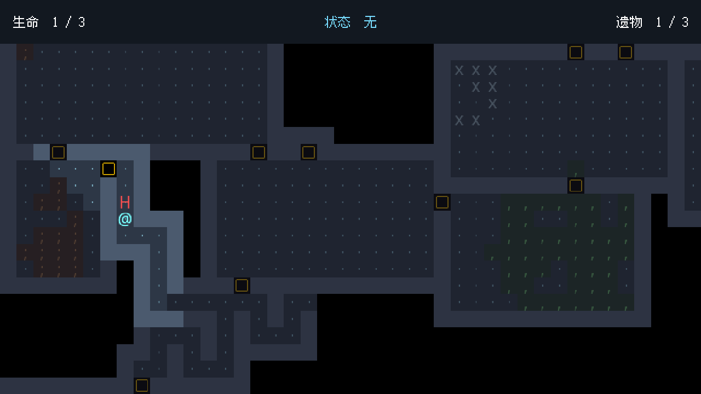
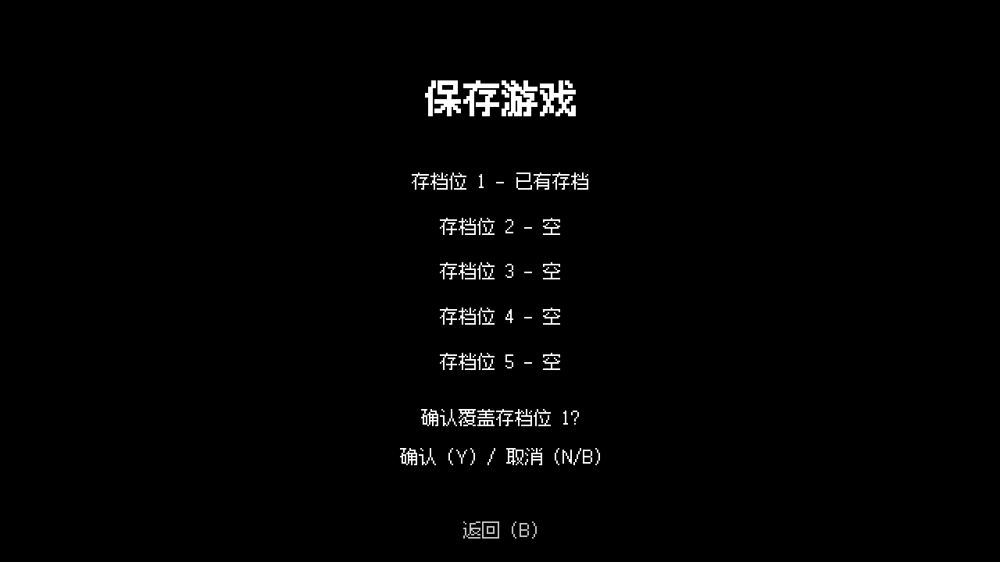
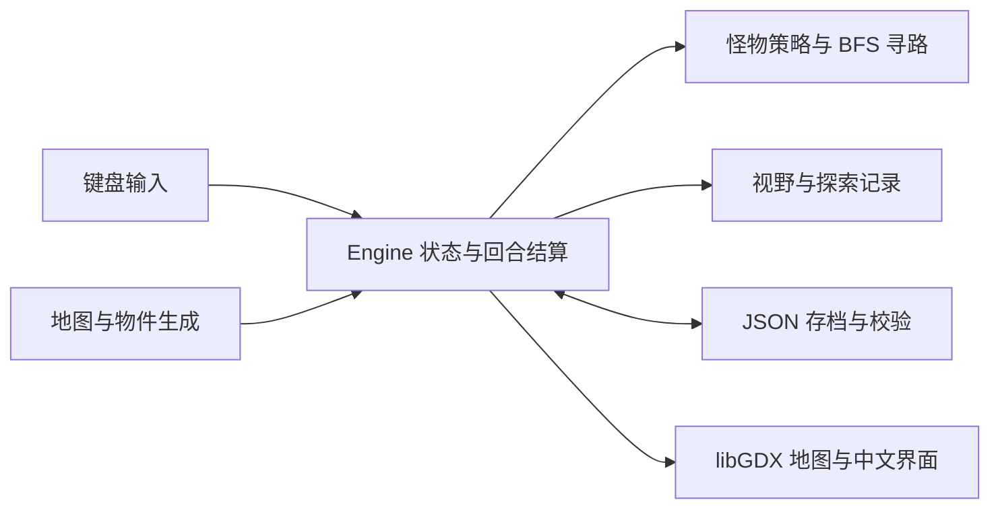

# BYOW · 地牢探险

围绕 CS61B Build Your Own World 主题实现的 Java 桌面地牢探索游戏，使用 libGDX 渲染。输入种子生成地图，在迷雾中收集遗物、应对怪物，并寻找出口。

地图上有 5 种遗物，收集任意 3 个就能激活出口。每次拾取都会激活对应怪物；继续收集第 4、5 个遗物还能获得增益。生命归零失败，存活并走进已激活出口获胜。

## 游戏画面





以上为 WSLg/X11 环境下实际渲染的游戏和存档覆盖确认画面。

## 已实现内容

| 模块 | 内容 |
|---|---|
| 地图 | 101 × 61 格；随机房间、迷宫、并查集区域连接、死胡同清理、地面装饰 |
| 回合 | 成功移动推进交互与怪物行动；撞墙、无效按键不推进；主动撞怪会结算伤害 |
| 怪物 | 猎手追踪、伏击者预测、守卫警戒与返回、巡逻者往返、胆小鬼追逃切换 |
| 遗物与增益 | 5 种固定映射；视野、回血、出口雷达、护盾、冻结 |
| 场景物件 | 尖刺陷阱、治愈泉、双向传送门、随机增益宝箱 |
| 界面 | 中文菜单、生命与增益 HUD、探索迷雾、怪物首次提示、鼠标悬停说明 |
| 存档 | 5 个槽位、覆盖确认、版本与数据校验、原子替换、失败提示 |

## 运行与操作

开发和构建使用完整 JDK 21。项目自带 Gradle Wrapper，无需单独安装 Gradle；首次构建需要联网下载依赖。已缓存依赖时可追加 `--offline`。

在项目根目录运行：

```bash
./gradlew :lwjgl3:run
```

Windows 使用 `gradlew.bat :lwjgl3:run`。桌面程序需要图形环境；在 WSL 中运行需要可用的 WSLg 或显示服务。

| 页面 | 按键 |
|---|---|
| 主菜单 | `N` 新游戏，`L` 读档，`Q` 退出程序 |
| 输入种子 | 输入 0～9223372036854775807，`S` 开始，退格删除，`B` 返回 |
| 游戏中 | `W/A/S/D` 移动，`P` 暂停；鼠标悬停查看当前可见格说明 |
| 暂停 | `P` 继续，`S` 保存，`Q` 返回菜单；未保存时先显示确认 |
| 保存/加载 | `1～5` 选择槽位，`B` 返回 |
| 覆盖确认 | `Y` 确认，`N/B` 取消 |
| 未保存退出确认 | `Y` 先选择槽位保存，`N` 放弃本次未保存进度，`B` 返回暂停 |
| 胜利/失败 | `N` 新游戏，`M/Q` 返回菜单 |

按键不区分大小写。种子相同会生成相同的地图、出生位置和初始遗物布局。

## 构建与验证

```bash
./gradlew :core:test :lwjgl3:classes
./gradlew :lwjgl3:jar
java -jar lwjgl3/build/libs/BYOW-1.0.0.jar
```

JAR 包含运行所需依赖和资源，运行需要 Java 21 或更新版本。macOS 启动时按 libGDX/LWJGL 要求添加 `-XstartOnFirstThread`。

JUnit 报告位于 `core/build/reports/tests/test/index.html`。当前自动化测试涵盖遗物与 Buff、怪物移动冲突、地图连通与确定性、存档真实读写、异常数据拒绝、覆盖取消、保存失败保护、输入状态机，以及存读档后继续游玩的结果一致性。写入测试使用 JUnit 临时目录，不覆盖玩家存档。

## 存档位置与兼容性

默认保存到**程序工作目录**下的 `save/slot1/save.json` 至 `save/slot5/save.json`。因此：

- 使用 Gradle 的 `:lwjgl3:run` 时，工作目录为 `assets/`，默认存档在 `assets/save/`。
- 从项目根目录执行上面的 `java -jar` 命令时，默认存档在根目录 `save/`。
- 可通过 JVM 属性固定存档目录，避免不同启动方式读到不同位置：

```bash
java -Dbyow.saveDir=/absolute/path/to/save -jar lwjgl3/build/libs/BYOW-1.0.0.jar
```

新存档带有 `formatVersion: 1`。没有版本号的旧存档允许读取，并沿用可选字段默认值；未来版本及不满足数据校验的文件会提示错误。当前没有完整的版本迁移层。

保存时先在同目录写临时文件，再执行原子替换；文件系统不支持原子替换时报告失败。该机制不保留多份历史备份。当前限制为单份文件最多 16 MiB、地图每个维度 3～1024 格。

## 实现结构



- `core` 保存游戏逻辑与测试；`lwjgl3` 提供桌面启动入口；`assets` 提供字体等资源。
- 地图生成将区域连接、死胡同清理与装饰分阶段处理；装饰与场景物件使用独立随机流。
- 怪物先依据回合开始时的位置计算意图，再由控制器统一处理占位和目标冲突；稳定 ID 决定冲突优先级。
- 存档保存随机数状态、怪物锁定目标、探索区域和增益状态。加载时先恢复完整候选状态，再替换当前游戏。

桌面工程框架由 [gdx-liftoff](https://github.com/libgdx/gdx-liftoff) 生成，渲染基于 [libGDX](https://libgdx.com/)，JSON 使用 Gson。


